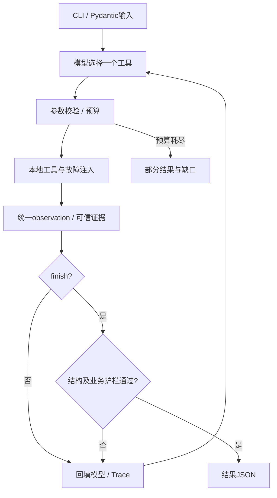

# 方案与取舍

## 调用流程

agent.py不根据素材ID或风险选择工具，业务动作由真实模型或Mock产生。真实接入使用OpenAI SDK Chat Completions function calling，temperature=0，关闭并行工具调用和SDK隐式重试。错误回填后由模型修正。

MockLLM从消息历史重建观察事实，再选择下一步，不读取expected结果、不回放Trace、不按case_id分支。Mock只验证流程，不证明模型的决策效果。build_result仅做证据投影，供Mock组装finish及运行时部分退出使用，不在真实循环中选择业务工具。

## 工具与动态决策

| 工具 | 作用与决策点 |
| --- | --- |
| read_asset | 读元数据；缺字段后补查，仍缺结束该项 |
| check_rules | 风险证据；high阻断，low待人工复核 |
| query_slots | 请求时段和同日后续整点；根据实际数据选候选 |
| request_confirmation | 记录问题并匹配外部回答；hard改时绑定精确范围 |
| save_draft | 事务保存/重复；失败观察后最多重试一次 |
| finish | 校验最终结果；拒绝后允许修正 |

工具统一 `{ok,data,error}`，reason为可选短依据。风险原因须完整引用工具原文以确定性校验；模型不可传accepted制造用户同意。无回答返回pending，不阻塞CLI。

## 保存和护栏

保存前与finish均检查原请求、审核证据、风险/补查、时段证据、改时标记、hard授权、批内冲突。高风险和缺资料不进入草稿子集。finish核对全部输入、待办及真实保存内容/ID，不能删候选跳过保存，递归禁词检查覆盖嵌套文本。

规则由rules.py校验并计算规范化内容指纹。即使版本标签未变，内容变化也使旧审核失效；保存/finish返回StaleReview要求重新check_rules，部分退出刷新规则并剔除失效审核。待办按实际证据覆盖检查，允许附带已查到的候选或实际风险代码；已解决确认不能再挂待办。

幂等键为规范化请求与排期事实的SHA-256：稳定排序、统一UTC，排除case_id/provider及自由说明，风险代码和有效确认参与。模型传auto，代码展开为真实key并记录Trace。

SQLite在BEGIN IMMEDIATE事务内查重、重查schedule、插入，UNIQUE兜底并发；重复返回原ID。每次运行最多两次持久化尝试，故障在副作用前注入。commit异常按key回查，未获确认不返回成功。

草稿不预占schedule，无冲突保证以保存时刻和本草稿内部为界，后续业务执行须再次查槽。

## 预算与Trace

默认12次决策与12次工具调度，finish、参数错误、注入失败计入工具预算，协议错误计入轮次。上限步finish成功正常结束，否则返回incomplete_step_limit和部分事实；模型接口失败返回incomplete_model_error。

Trace缓冲一行，拿到下一步实际动作才写next_action，终止填end/budget_exit/model_error。摘要≤200字符，完整工具结果交给模型。provider和source_case_id标明来源，_mock/_real防覆盖，不记录认证配置或异常响应正文。

## 取舍与限制

使用标准库CLI/SQLite和少量模块；未引入框架、服务、UI、多Agent与部署。固定直接依赖：openai 1.109.1、socksio 1.0.0、httpx 0.28.1、pydantic 2.11.7、python-dotenv 1.1.0、pytest 8.3.4。

真实配置兼容OPENAI_BASE_URL/OPENAI_API_KEY，非空LLM_*变量优先；provider的openai别名统一为real以保持证据路径一致。缺失SDK或代理依赖时报告配置错误，不泄漏认证内容。

真实接口须支持function calling。默认发送parallel_tool_calls=false，不接受此参数时可设LLM_SEND_PARALLEL_TOOL_CALLS=0；运行时依旧只允许单工具。当前配置已通过10个真实场景及省略参数模式；19项原生SDK HTTP契约测试为离线模拟，其他厂商仍需实测。确认边界是本地输入，未实现身份认证。1小时整点、同日后续候选和低风险规则为合成约定。禁词为字符串检查。多素材可提高预算，16项跟进场景已验证容量不足和部分退出。
