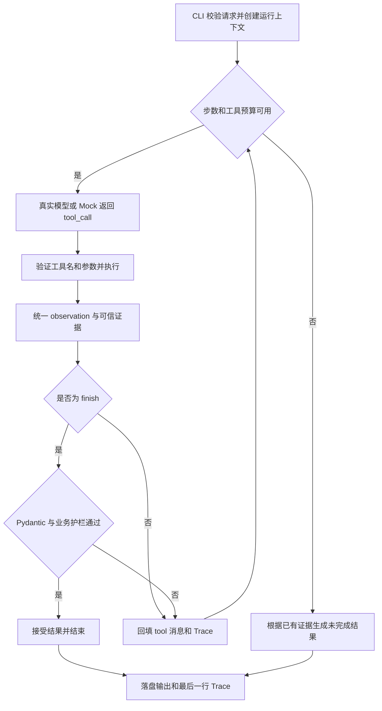

## Context

### 需求来源与约束

本设计依据根目录的三份文件，按“统一考试规范 → 选题业务要求 → README 中的具体工程与验收约束”合并需求：

| 来源 | 提取的约束 |
| --- | --- |
| `小影科技2027校招AI Agent笔试题.md` | 真实模型决策循环、至少两条动态路径、执行上限、可运行交付、如实记录 AI 使用与验证 |
| `素材审核与发布排期Agent.md` | 素材审核、冲突调整、确认边界、仅存草稿、重复提交和保存失败 |
| `README.md` | 包名与目录、六个工具、Pydantic、SQLite、12 步默认上限、故障注入、八个必需用例及明确护栏 |

提案建立时仓库没有业务代码、已有能力规格或运行证据。本文件中的示例与验收表为设计预期，实际实现和验证结果见 `docs/02-solution.md`、`docs/03-evaluation.md` 与 `examples/results.md`。

## Goals / Non-Goals

**Goals:**

- 以少量 Python 模块实现真实模型选择工具、观察结果、调整下一步的完整循环。
- 对每项素材给出有证据的审核结论、时间建议和待确认项，并保存无内部冲突的草稿。
- 用代码保证硬性时间授权、幂等事务、保存结果真实性和有界执行。
- 离线复现全部业务路径，并为真实模型的正常/冲突路径保留可直接运行的验证入口。

**Non-Goals:**

- 不接入真实内容平台，不实现任何发布工具或发布函数。
- 不实现 UI、HTTP 服务、部署、多 Agent、向量检索或生产调度器。
- 不将规则化 Mock 的流程正确性等同于真实模型的决策效果。

## Decisions

### 1. 原生单 Agent 循环与模块边界

采用 Python 3.11+、标准库 `sqlite3`/`argparse`、OpenAI SDK、Pydantic 与 pytest。先实现 CLI 核心链路；无需图框架的持久化和分布式能力，因此不引入 Agent 框架。依赖的具体固定版本由实现阶段安装与验证后写入 `requirements.txt`，本设计不声称版本已经验证。

```text
src/schedule_agent/
  cli.py            # 配置、CaseSpec、文件输出和退出码
  agent.py          # 通用 ReAct 循环、预算、消息回填
  llm.py            # 相同接口的 OpenAICompatibleLLM / MockLLM
  prompts.py        # 工具使用、停止、追问、禁止编造的系统提示词
  tools.py          # 六个工具、注册表、统一异常边界
  schemas.py        # 请求、工具参数、确认记录、结果的 Pydantic 模型
  guards.py         # 保存前与 finish 校验、规范化与幂等键
  storage.py        # SQLite 查询、事务与 seed 共用的数据操作
  trace.py          # JSONL、摘要、next_action 回填和脱敏
scripts/
  seed_db.py        # 显式初始化合成数据库；测试不共享 data/app.db
  run_all_cases.sh  # 夹具准备、重复请求共享库、逐个执行和结果汇总
```

`agent.py` 只能做协议调度、预算与安全约束，不依据 M01/M02 等 ID 或风险等级选择业务工具。业务动作顺序由模型产生；Mock 的 observation 策略只存在于 `MockLLM` 内。`RuntimeContext` 为每次运行保存可信证据：原始请求、成功读取/审核结果、已查时段、可信确认、工具调用计数、保存尝试及返回，不建立复杂状态机框架。



### 2. 输入与结果契约

用 `RunRequest` 区分用户请求与用例执行配置。`asset_ids` 为非空去重列表；`requested_times` 的键必须与其完全一致；每项使用 `time` 和 `type: hard|soft`；一个请求使用同一 `channel`。不同渠道分次运行，减少非必要抽象。

```json
{
  "asset_ids": ["M01"],
  "channel": "video",
  "requested_times": {
    "M01": {"time": "2026-10-30T18:00:00+08:00", "type": "soft"}
  },
  "confirmations": []
}
```

- 时间必须含时区并落在整点；以 `Asia/Shanghai` 的业务日期查询，一条素材占一个小时。比较和持久化统一为 UTC，展示统一为带 `+08:00` 的 ISO 8601。拒绝无时区、未知类型、重复素材、缺失时间和越界日期，不静默猜测。
- `CaseSpec` 外层包含 `case_id`、`request`，以及仅供 CLI/夹具使用的 `fixture`、`preset_answers`。数据库路径、模型配置、故障配置为运行参数，不是用户业务请求，也不进入幂等键。
- `Confirmation` 包含 `asset_id`、`kind: time_change|risk_ack`、`accepted`；时间确认还绑定 `proposed_time`，风险确认绑定 `risk_codes`。未匹配本素材/本候选值的确认不生效。
- 可信确认只来自原始请求和 `request_confirmation` 工具读取的外部预设回答；模型传入的描述、`reason` 或 `finish` 字段不能制造确认。

`AgentResult` 定义如下：

| 字段 | 类型与含义 |
| --- | --- |
| `items` | `AssetResult[]`；正常 finish 必须覆盖输入素材且每项恰好一次 |
| `items[].asset_id` | 原请求素材 ID |
| `items[].review_status` | `approved|blocked|needs_info`；approved 表示规则审核通过或允许形成待确认草稿，不表示人工终审完成 |
| `items[].risk_reasons` | 完整引用工具返回的原因列表，保持可确定性核验 |
| `items[].requested_time` | 原请求时间，不可改写以掩盖时间变更 |
| `items[].suggested_time` | 可执行建议时段或 `null`；信息不足、高风险、未确认 hard 冲突时为 `null` |
| `items[].needs_confirmation` | 改过时间或有低风险时必须为 true；即使改时已确认仍为 true，满足题目的改时标记规则 |
| `items[].confirmation_reason` | 说明确认原因及已确认/未确认状态；无确认需要时为 `null` |
| `draft_status` | `saved|duplicate|failed|not_saved` |
| `draft_id` | 保存或重复时的真实 ID，其他情况为 `null` |
| `status` | `completed|needs_attention|incomplete_step_limit|incomplete_model_error` |
| `pending_items` | 结构化待处理项：`asset_id`（可为空）、`kind`、`message`、相关候选时间或风险代码 |

`completed` 表示本次处理完成且没有未解决项；已保存但仍待确认、素材阻断或缺资料时为 `needs_attention`。`needs_confirmation` 表示该建议涉及确认要求；`pending_items` 只放尚未解决的事项，因此“已经确认的改时”可保留标记而没有待确认项。

预算退出和模型接口失败的部分结果，只包含有足够证据的素材项；尚未审核的素材写入 `pending_items(kind=unprocessed)`，不编造三种审核状态。此时保存状态仍从真实记录恢复。输入或配置无效时 CLI 在运行前报结构化错误，不冒充一次已完成的 Agent 运行。

### 3. 真实 ReAct、Mock 与有界终止

真实客户端读取 `LLM_BASE_URL`、`LLM_API_KEY`、`LLM_MODEL`，显式设置 `temperature=0`；用 SDK 的 Chat Completions function calling 完成协议，适配器输出统一 `AssistantMessage(tool_calls)`。模型请求和网络超时有界，SDK 自动重试设为 0，接口错误生成 `incomplete_model_error`，写明缺口并保留已有 Trace；具体超时值通过配置设置，默认 30 秒。

每轮要求一个工具调用。若接口支持，关闭并行工具调用；无论接口是否支持，运行时都检查工具调用数。多工具响应不执行任何业务工具，逐一回填协议错误；纯文本响应、未知工具、无效 JSON 或无效参数也返回可纠正的 observation。存在 tool_call_id 时使用匹配的 tool 消息；纯文本无调用 ID 时追加协议纠错 user 消息，不制造无关联的 tool 消息。协议错误消耗模型轮次，避免空转。

运行时循环：

1. 预算允许时调用模型，`step` 增加 1。
2. 将模型消息加入历史；验证唯一调用并执行注册表中的工具。没有把素材内容解释为系统指令的执行路径。
3. 捕获业务异常，归一化 observation；更新仅由工具结果支持的证据。
4. 通过 `tool_call_id` 将 observation 回填模型；若 `finish` 失败，则同样回填并继续。
5. `finish` 成功时终止；达到任一预算时不再调用模型或工具，输出未完成结果。

`MAX_STEPS=12` 限制模型决策轮次；`MAX_TOOL_CALLS=12` 默认限制工具调度尝试，包括 `finish`、参数错误和注入失败。协议错误没有工具执行，但仍消耗轮次。CLI 可为批量素材提高两项预算，不能因默认值不足而省略验证。第 12 步若 finish 校验通过即成功；第 12 步尚需下一步时才返回 `incomplete_step_limit`。工具预算耗尽同样使用题目指定的状态，在待处理项写明耗尽的是哪项预算。

正常与业务失败结果均通过模型调用 `finish(result, reason)` 结束。只有预算耗尽、模型调用失败等模型无法继续的运行时异常允许代码构造经过同一结果模型和证据护栏的部分输出。

Mock 不回放脚本或缓存日志：从最近 observation 及消息历史提取“尚未读取/审核、缺字段补查次数、已查候选、已确认事项、保存次数”等事实，生成与真实客户端相同的 tool_calls。把可用时段从 19:00 改成 20:00 后，Mock 必须随 observation 改变参数；该验证只说明流程依赖工具结果。

### 4. 工具协议与错误语义

所有工具采用以下 envelope，错误时 `data=null`，成功时 `error=null`。`reason` 是每个工具的可选短字符串，表示对外简要依据，不请求或保存内部思维过程。

```json
{"ok": true, "data": {}, "error": null}
```

```json
{"ok": false, "data": null, "error": {"type": "SlotUnavailable", "message": "指定时段已占用"}}
```

| 工具 | 参数（均另有可选 reason） | 成功时 data / 作用 |
| --- | --- | --- |
| `read_asset` | `asset_id` | 完整素材元数据、缺失字段、修订信息；M02 补查后仍缺资料 |
| `check_rules` | `asset_id` | `risk_level: none|low|high`、`risk_codes`、`risk_reasons`、`missing_fields`、规则版本；服务端读取素材而非相信模型转述 |
| `query_slots` | `channel, date, around_time` | 指定时间是否可用、当日附近空闲时段、占用证据；不返回窗口之外的暗示性承诺 |
| `request_confirmation` | `asset_id, question`；可选 `confirmation_type, proposed_time, risk_codes` | 记录待确认项并匹配预设回答；返回 accepted/rejected/pending 和确认范围 |
| `save_draft` | `items, idempotency_key` | `draft_status: saved|duplicate`、`draft_id`、`idempotency_key`、规范化内容摘要；失败走 error envelope |
| `finish` | `result` | 校验通过时接受 AgentResult；失败返回 ValidationError/GuardViolation 供模型修改 |

两个确认范围参数用于让时间/风险授权可校验，不增加第七个业务工具。无类型信息的普通追问只记录问题，不能授权 hard 改时。用例模式无匹配回答时返回 pending，CLI 不阻塞等待输入。

异常类别至少包括 `AssetNotFound`、`InvalidArguments`、`RuleDataError`、`SlotUnavailable`、`GuardViolation`、`InjectedFailure`、`StorageError`。缺字段或命中风险是正常业务 observation，不包装成工具执行失败。工具异常一律通过 observation 回填，不终止整个进程。

### 5. 审核、排期与确认的业务语义

| 证据条件 | 模型应选择的动作 | 结果与保存资格 |
| --- | --- | --- |
| M01，字段完整，无风险 | 读取、规则检查、查时段 | approved；可用时形成候选 |
| M02，title/版权信息缺失 | 至少再读一次补查；仍缺则停止该项排期 | needs_info，suggested_time=null，不进入草稿 |
| M03，违规词/未授权音乐等高风险 | 阻断并说明规则依据 | blocked，suggested_time=null，不进入草稿；用户同意也不能绕过 |
| M04，边界低风险 | 记录风险，可请求人工复核确认 | approved 且 needs_confirmation=true；可保存带待确认标记的草稿 |
| soft 时间已占用 | 查询并核实替代时段 | 建议可用替代时间，needs_confirmation=true，可先存待确认草稿 |
| hard 时间已占用且无授权 | 请求确认；无回答或拒绝时停止该项排期 | 保持原 requested_time，suggested_time=null，pending_items 说明原时段冲突 |
| hard 候选改时已被明确接受 | 查询该候选是否仍可用 | 保持原 requested_time，建议已确认时间，needs_confirmation=true，可保存 |
| 时段查询/审核工具失败 | 根据 observation 重试或继续补查 | 没有成功证据的项不能进入草稿；预算用尽则部分返回 |

高风险优先于缺字段，缺字段优先于低风险可排期；不能以补齐标题掩盖已发现的违规。多素材逐项获取证据，最后按原输入顺序展示；保存子集只包含通过校验且有具体时段的素材。`save_draft.items` 是该可保存子集，`finish.result.items` 包括本次已处理的全部素材，护栏必须验证两者对应关系。

单次查询返回 `around_time` 自身的可用性，以及当日更晚的可用整点列表，按时间升序排序；替代建议默认不提前到原请求之前。基础夹具占用18:00、19:00可用；变体保留18:00占用并新增19:00占用、20:00可用。两次都请求18:00，使建议变化只由 observation 变化引起。模型选择候选后需有该具体时段可用的查询证据，不得自行固定加一小时。相同渠道的一小时区间不能与已有 schedule 或本批次其他候选重叠。

草稿不预约真实排期，不写入 `schedule`；多份不同草稿可以提出相同时段。系统保证的是保存当时对已排期和本草稿内部的无冲突校验，后续确认或真实执行前仍需另行校验，超出本题范围。

### 6. SQLite 数据与事务幂等

| 表/文件 | 核心字段 |
| --- | --- |
| `assets` | `asset_id PRIMARY KEY, title, copyright_status, content, music_authorized, manual_review_required, revision` |
| `schedule` | `id PRIMARY KEY, channel, start_time_utc, asset_id`；唯一约束 `(channel, start_time_utc)` |
| `drafts` | `draft_id PRIMARY KEY, idempotency_key UNIQUE, request_json, items_json, created_at` |
| `data/review_rules.json` | 规则版本、必填字段、禁用词、版权要求、风险等级和处理方式 |

运行中确认记录保存在上下文，最终反映在输出和草稿内容中，无需额外数据库表。测试使用 `tmp_path` 数据库；`seed_db.py` 初始化 M01–M04 和固定业务日期，只在显式重置时清除数据，正常运行不重新 seed。

幂等算法不是由模型自由定义：

1. 对业务请求去除 case_id、faults、模型配置、reason 等运行信息；对资产列表、映射和确认项稳定排序，时间统一 UTC，空确认统一为空列表。
2. 对待保存结果按 asset_id 排序，使用稳定业务字段：asset_id、channel、review_status、requested_time、suggested_time、risk_codes、needs_confirmation 和有效确认事实。风险说明、确认说明的自由措辞、生成时间、draft_id 均不进入哈希。
3. 使用 `json.dumps(..., sort_keys=True, separators=(",", ":"), ensure_ascii=False)` 构造规范化请求及排期结果，计算 UTF-8 的 SHA-256。风险代码从可信审核证据提取，其他排期事实与证据校验后参与计算；不要求模型在最终结果中额外生成 risk_codes 字段。
4. 待保存 items 的确定性业务字段与可信证据比对，任何缺审核、无时段证据、hard 未确认、改时未标记或内部冲突都先拒绝，再处理事务。
5. `BEGIN IMMEDIATE` 后优先检查相同 key。存在则返回原 ID 和原内容，不再插入；不存在则在同一事务重新检查 schedule、插入草稿并 commit。唯一约束兜底并发重复请求，锁等待有界；失败 rollback。

为了让 hash 对真实模型可用，不要求模型自行计算 SHA-256。实现时 `save_draft` 工具参数中的 `idempotency_key` 允许使用约定字面量 `auto`，由调度器在校验后展开成真实哈希；显式给出哈希时必须匹配。Trace 记录展开后的实参，数据库只接收真实哈希。保留此参数满足工具接口，同时减少与业务无关的工具往返。

重复请求根据相同规范化业务字段产生相同 key；确认状态或候选时间发生变化则产生不同 key。读取同 key 旧草稿时返回的是既有建议，不保证其时段仍空闲；若查询发现时段已变且要求重新规划，应构造新的有效候选并生成新 key。当前八个用例中 duplicate 与 soft 冲突用例共享数据库且不改变 schedule，以证明同内容恰好一条。

### 7. 保存证据与 finish 护栏

护栏同时用于 `save_draft` 和 `finish`，不能只在结果输出后发现越权写入：

- **输入不变性**：结果素材必须属于原请求；requested_time、channel、hard/soft 以原请求为准，不能让模型改写前提。
- **审核真实性**：approved 必须有成功的读取和规则检查证据；blocked/needs_info 的原因匹配工具结果；缺字段项有补查记录。风险原因完整引用工具原文，避免无法确定性校验的自由改写。未知或读取失败不伪装成审核通过。
- **时间与确认**：任何非空 suggested_time 与 requested_time 不同都必须 needs_confirmation=true；hard 改时还需匹配候选时间的可信 accepted 确认。高风险、缺资料、已占用时段以及批内冲突不允许保存。
- **低风险**：保留真实风险、确认原因及未解决确认项，不允许模型删除标记后保存。
- **保存真实性**：saved/duplicate 必须与本轮成功 save_draft 的 ID、key、内容一致，并可在数据库查得；不能拿另一条历史草稿证明当前候选已保存。failed 必须有真实保存尝试且没有已确认成功；not_saved 只用于未尝试持久化的结果。有合法可保存候选时必须先尝试保存才能正常 finish，不能以 not_saved 绕过核心流程。
- **保存后不漂移**：finish 如修改已保存项的建议时间、风险或确认事实，必须重新保存相应内容，不能复用旧 draft_id。仅修改说明措辞不构成新的排期结果。
- **待办一致性**：未授权变更、低风险未复核、信息缺失及未处理素材必须如实出现在 pending_items；正常 finish 不得漏项或有重复项。
- **输出措辞**：递归检查最终结果中的文本字段，经 Unicode 规范化后拒绝含“已发布”“已上线”等禁用词的表述。提示词统一使用“草稿已保存”“待确认”；禁词按子串检测，包含禁词的否定句同样拒绝，具体禁词表与测试保持一致。

`finish` 参数先通过 Pydantic，再跑证据护栏；失败作为本步 observation 返回，可让模型修正，计入预算。保存失败可由模型重试一次，每个运行最多两次持久化尝试，注入失败同样占用次数；无效参数或保存前护栏拒绝消耗工具预算，但不算实际持久化尝试。第一次失败后观察错误再决定重试，不能在循环外偷偷重试；两次失败后再次 save_draft 返回 RetryLimitExceeded，不产生第三次写入。此时 draft_status=failed，draft_id=null，pending_items 包含保存缺口。

注入器在副作用前失败，因此不会出现“数据库已提交但工具报注入失败”。SQLite commit 异常时按 key 回查确认是否已存在；只有已确认持久化才能返回 saved/duplicate，无法确定时返回 StorageError 并说明需核实。此时 failed 仅表示本次保存未得到成功确认，pending_items 必须标明不确定性，不能断言数据库绝无记录。注入用例因失败在副作用前，可明确断言无新增行。

### 8. Trace、故障注入与证据文件

故障参数采用 `--faults "save_draft:1,save_draft:2"` 或 `FAULTS`；CLI 覆盖环境变量，每次运行重新计数，相同工具的重复条目累积为集合。格式、未知工具、非正整数在执行前拒绝。业务工具在参数校验通过后递增调用序号，命中时在读取/写入前返回 InjectedFailure；`finish` 的护栏不支持注入绕过。无效参数仍消耗工具预算，但不消耗该业务工具的故障序号。

每次决策轮写一行 `examples/traces/<case_id>.jsonl`，字段包含 `step, action, args, observation_summary, next_action, decision_note`；可扩展 provider、run_id、tool_call_id、error_type。摘要最多 200 个字符，保存完整 envelope 于模型历史，摘要不替代 observation。无有效单工具调用时 action 为 `invalid_response`，记录协议错误；模型接口失败可另记 `model_error` 事件，不伪造工具调用。

`next_action` 来自下一轮实际选择，不能提前猜测。Trace writer 只缓冲最近一行：拿到下一轮动作后补齐并追加上一步；终止时填 `end`、`budget_exit` 或 `model_error` 并 flush。`decision_note` 直接取可选 reason，缺省为空，不由程序杜撰。敏感模型配置与认证头不落盘；case_id 限定安全字符，禁止路径穿越。

保存工具在成功observation中保留已校验的完整结果快照。运行时预算/模型异常退出时使用该快照报告已保存部分，避免后续查询改变已保存候选；该路径依赖本次已确认提交的工具证据，不强制重新访问数据库。正常finish仍核对当前业务证据、保存内容与数据库。

输出写入 `examples/outputs/<case_id>.json`，Trace 增加 provider 与 source_case_id，结果本身保持 AgentResult schema。用例文件提供基础 case_id，CLI 按 provider 自动形成 normal_mock、normal_real 等执行 ID，避免覆盖 Mock 证据；验收表中的基础文件名是逻辑名称，实际路径带对应 provider 后缀。真实输出只由实际接口调用生成，不运行就不生成。

### 9. 验收矩阵与运行约定

下表全部是预期值，实际结果在实现后填入 `examples/results.md` 和 `docs/03-evaluation.md`。

| 验收 ID / case | 输入与夹具 | 预期 | 测试与证据规划 |
| --- | --- | --- | --- |
| A01 normal | M01，19:00 可用 | approved，saved，completed | cases/normal.json → outputs/normal.json、traces/normal.jsonl |
| A02 missing_info | M02，补查仍缺字段 | needs_info，not_saved，needs_attention | Trace 至少含两次 read_asset，无该项保存 |
| A03 rule_risk | M03，禁用词/未授权音乐 | blocked，not_saved，写明风险 | 检查规则与输出对应，高风险禁止保存 |
| A04 slot_conflict | M01，18:00 soft 占用 | 建议19:00，待确认，saved，needs_attention | 检查查槽证据、改时标记与草稿 ID |
| A05 slot_conflict_hard | M01，18:00 hard，无回答 | suggested_time=null，not_saved，请求确认或明确阻断 | 无授权改时，pending_items 保留冲突 |
| A06 duplicate | 再提交 A04，保持数据库 | duplicate，原 draft_id，drafts 总数为1 | 同 request 不同 case_id，不重置数据库 |
| A07 save_failure | M01，合法时间；注入保存第1、2次失败 | failed，无 draft_id，不称成功 | 两次失败 observation，drafts 无新行 |
| A08 slot_swap | 独立夹具：18:00、19:00均占用，20:00可用；仍请求18:00 soft | 建议20:00，saved，待确认 | 与 A04 保持相同业务输入，只变工具数据，排除硬编码19:00 |
| A09 low_risk | M04 边界风险 | 可存待确认草稿，风险保留 | pytest 补充用例，覆盖 low 分支 |
| A10 hard_confirmed | hard 冲突，可信回答接受19:00 | 建议19:00且保留改时标记，可存 | 校验接受的是精确候选，拒绝错误素材/时间确认 |
| A11 budgets | 缩小步数/工具预算或模型持续非法调用 | incomplete_step_limit，部分结果与缺口 | 边界成功、拒绝 finish、部分已保存结果 |
| A12 guards | 伪造保存、漏项、改时未标记、禁词、批内冲突 | 保存/finish 被拒绝，可修正 | 直接护栏单测与带错误调用的循环测试 |

用例基准日期统一为 2026-10-30，常规夹具占用18:00，允许19:00；slot_swap 夹具占用18:00和19:00，允许20:00。`run_all_cases.sh` 为独立用例建立独立数据库，只为 A04→A06 保留同库状态，且检查总行数。对任何断言失败继续汇总并以非零退出；不能只看 CLI 是否成功退出。

计划实现后可复制的入口：

```bash
python -m venv .venv
source .venv/bin/activate
pip install -r requirements.txt
python scripts/seed_db.py --db data/app.db
LLM_PROVIDER=mock python -m schedule_agent.cli run --case examples/cases/normal.json
pytest -q
LLM_PROVIDER=mock bash scripts/run_all_cases.sh
```

实现时用 pytest 配置让 src 布局在上述命令中可导入。真实模型配置写在 `.env.example`，不给默认真实密钥；真实客户端缺配置时明确失败，不自动切换 Mock。真实模型至少实际运行 normal 与 slot_conflict，或 slot_conflict 与 slot_swap；没有密钥时状态必须标为“待真实模型运行”，不生成假 trace。

文档分工：`docs/01-requirements.md` 承接 A01–A12 及工程硬约束；`02-solution.md` 提供流程、工具和取舍；`03-evaluation.md` 逐项列预期/实际/证据/限制；`04-ai-usage.md` 只填可确认的 AI 产物事实、个人贡献留空；`05-retrospective.md` 留个人复盘模板。README 为环境、命令、评审入口与 Mock 边界；`examples/results.md` 为 Mock 与 real 分列的实际汇总。

## Risks / Trade-offs

- [模型接口对 function calling 支持不一致] → 将差异隔离在 llm.py，真实验证记录 provider/model；不以 Mock 测试证明接口可用。
- [多素材任务超过默认12步] → 明确可提高预算，默认不足时给部分结果和缺口，不削弱护栏。
- [模型忽略 tool schema 或伪造 reason] → reason 仅用于短说明，所有副作用依据可信证据再校验。
- [单次模型失败导致提前返回] → 使用有界超时保留证据，初版不添加多层重试；保存重试仍由模型显式选择。
- [草稿保存后真实排期变化] → 草稿不占用 schedule；保证保存当时校验，后续执行需要重新查槽。
- [SQL 锁竞争与保存结果不确定] → 有界等待、事务、唯一约束和按 key 回查；不能确认时如实保留异常。
- [固定禁词存在误拒绝或同义词漏检] → 提示词采用草稿专用措辞，单测覆盖题目禁词；不声称完成通用内容安全检测。
- [规则变动导致历史建议变化] → 固定合成资料、规则版本与用例日期；幂等键使用规范化业务事实，不使用模型自由文本。

## Migration Plan

这是空仓库的首次实现，无线上迁移。先落请求模型与合成数据，再实现工具/护栏，然后接入真实与 Mock 循环，最后生成实际证据与交付文档。保留三份原始需求的内容；改写 README 为运行入口时在 docs 中存放需求来源映射。数据库由脚本创建，重置必须显式选择；失败回滚由 SQLite 事务处理。本次设计不创建数据库或改写根目录需求文件。

## Open Questions

- 真实接口的 base URL、模型名、密钥与可调用额度在真实验证时配置；不阻塞离线实现，也不把未调用记为通过。
- 外部题目未定义每条素材占用时长、替代时段方向和低风险细则，本设计采用“一小时整点槽位、替代候选取同日后续时段、低风险可存待确认草稿”的固定合成规则；未来支持可变时长时需要更新规格与冲突检测。
- 当前确认以本地输入/预设回答为信任边界，未实现用户身份认证，符合离线笔试范围。
